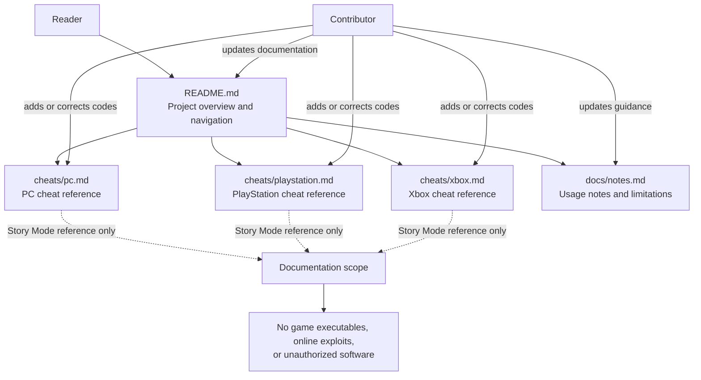

# Architecture Overview

This repository is a documentation-only reference for GTA V Story Mode cheat codes. The README is the entry point, with platform-specific cheat lists and shared usage notes organized as separate Markdown files.

## Data flow

1. Readers start at `README.md` and choose the reference for their platform.
2. Platform cheat files provide the relevant code or controller combinations.
3. `docs/notes.md` documents shared usage guidance and limitations.
4. Contributors maintain these files through focused documentation changes and pull requests.

The repository contains reference documentation only; it does not interact with or modify the game.
